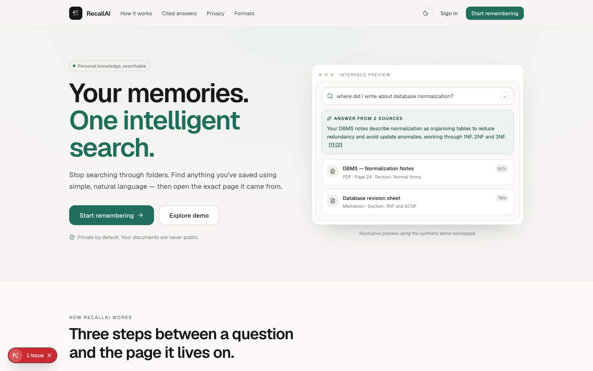
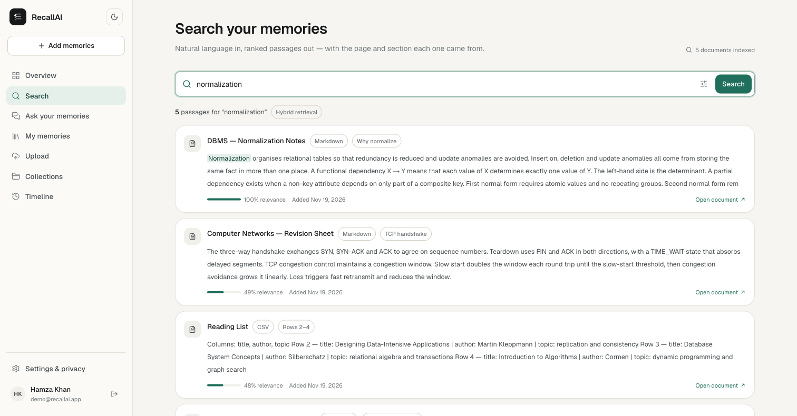
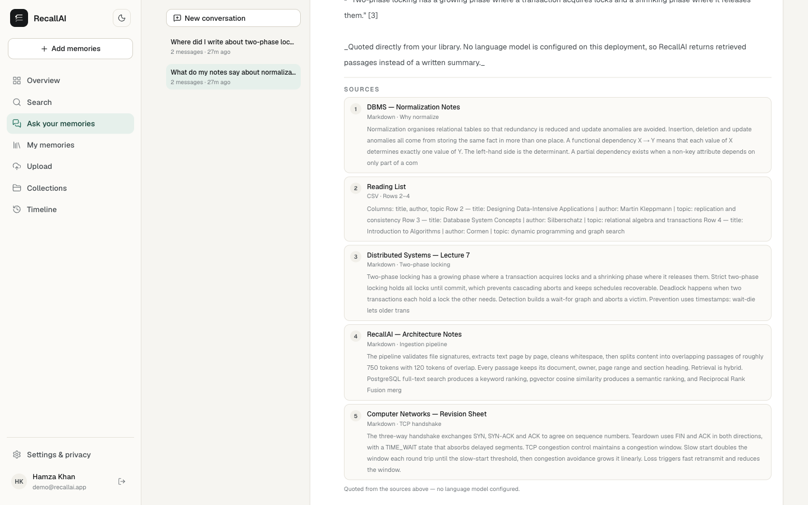
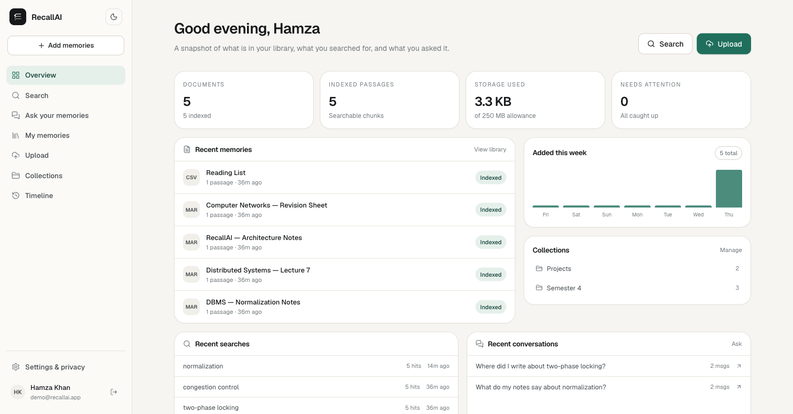

<div align="center">


# RecallAI

**Your memories. One intelligent search.**

A private, AI-powered search engine for your own notes, PDFs, slides and screenshots.
Upload once, then find anything with natural language — and open the exact page it came from.

[](https://github.com/MHK-ctrl/RecallAI/actions/workflows/ci.yml)
[](LICENSE)
[](https://nextjs.org)
[](https://github.com/pgvector/pgvector)

</div>

> **LIVE DEMO →** {{LIVE_URL}}
>
> **REPOSITORY →** https://github.com/MHK-ctrl/RecallAI

---

## The problem

Your information is spread across lecture notes, PDFs, slides, screenshots, chat
exports and half-finished markdown files. You know you wrote about database
normalization somewhere. You cannot remember which file, or which page.

RecallAI gives you one private place to put it, and one natural way to ask for it
back.

## What it does

- **Upload almost anything** — PDF, DOCX, TXT, Markdown, CSV, PNG, JPG, WEBP.
  Drag several files at once and watch each stage of indexing in real time.
- **Extract with structure** — PDFs keep page numbers, Markdown keeps headings,
  CSVs keep columns, images go through OCR when available.
- **Chunk for retrieval** — ~750-token overlapping passages, each with its owner,
  document, page range and section.
- **Search hybrid** — Postgres full-text ranking fused with pgvector cosine
  similarity (Reciprocal Rank Fusion), plus a substring fallback so a query never
  silently returns nothing.
- **Ask your memories** — retrieval-first RAG with numbered citations to real
  chunks, page and section links, and an explicit "I could not find that" answer.
- **Stay organised** — collections, tags, filters, a memory timeline and a
  document viewer with in-document matches.
- **Own your data** — per-account isolation on every query, private file
  streaming, JSON export, cascade deletion, and a plain-language privacy page.

## Screenshots

| Landing | Search |
|---|---|
|  |  |

| Answer with citations | Dashboard |
|---|---|
|  |  |

Screenshots are captured from the running application with a synthetic sample
library. No real user data is shown.

## Try it in one minute

1. Open the live demo (no account needed) to explore search and cited answers on a
   synthetic workspace.
2. Create an account, upload a lecture PDF or a markdown note.
3. Search for a phrase you remember, or ask a full question.

## How it works

```
upload → magic-byte validation → extract (page-aware) → clean
      → overlapping chunks (+ page/section) → embeddings → PostgreSQL

question → hybrid retrieval (FTS + pgvector, RRF) → numbered context
        → chat model (optional) → citation validation → answer with real sources
```

More detail: [architecture](docs/ARCHITECTURE.md), [database](docs/DATABASE.md),
[AI configuration](docs/AI.md).

### Two honest modes

RecallAI does not pretend a model is doing something it is not.

| Configured | Search | Answers |
|---|---|---|
| No AI keys | Full-text + local lexical vectors | Quoted passages with citations, labelled as extractive |
| Chat + embeddings | Hybrid semantic retrieval | Written answers with validated citations |

The **local lexical vector** is a deterministic hashing embedder, not a neural
model. It keeps the full hybrid path working without credentials. Configure an
embedding provider for meaning-based recall.

## Technology

- **Framework** — Next.js 16 (App Router), React 19, TypeScript strict
- **UI** — Tailwind CSS 4, Lucide icons, Motion, hand-built design tokens
- **Data** — PostgreSQL 15+, pgvector, `pg` (no ORM), versioned SQL migrations
- **Auth** — scrypt password hashing, DB-backed sessions, HttpOnly cookies
- **Extraction** — `unpdf` (PDF, per page), `mammoth` (DOCX), custom CSV parser,
  `tesseract.js` (OCR)
- **AI** — provider-independent OpenAI-compatible chat + embeddings, RAG with
  citation validation
- **Tests** — Vitest, database-backed isolation tests, GitHub Actions with a
  pgvector service container

## Run locally

```bash
git clone https://github.com/MHK-ctrl/RecallAI.git
cd RecallAI
npm install
cp .env.example .env.local
```

Start PostgreSQL with pgvector (Homebrew example):

```bash
brew install postgresql@17 pgvector
initdb -D .localdb -U postgres --auth=trust
pg_ctl -D .localdb -l .localdb/server.log -o "-p 5433" start
createdb -h 127.0.0.1 -p 5433 -U postgres recallai
psql -h 127.0.0.1 -p 5433 -U postgres -d recallai -c "CREATE EXTENSION vector;"
```

Set `DATABASE_URL` and `SESSION_SECRET` in `.env.local`, then:

```bash
npm run db:migrate
npm run dev          # http://localhost:3000
```

Quality checks:

```bash
npm run typecheck
npm run lint
npm test             # create/migrate recallai_test first for the DB tests
npm run build
```

## Environment variables

| Variable | Required | Purpose |
|---|---|---|
| `DATABASE_URL` | yes | PostgreSQL with pgvector |
| `SESSION_SECRET` | yes (prod) | 32+ chars, signs file URLs and sessions |
| `APP_URL` | yes (prod) | Canonical origin for metadata and reset links |
| `MAX_UPLOAD_MB` | no | Default 8; use 4 on Vercel (4.5 MB body cap) |
| `USER_STORAGE_QUOTA_MB` | no | Default 250 |
| `MAX_CHUNKS_PER_DOCUMENT` | no | Default 400 |
| `OCR_ENABLED` | no | Default true |
| `LLM_BASE_URL`, `LLM_API_KEY`, `LLM_MODEL` | no | Written, grounded answers |
| `EMBEDDING_BASE_URL`, `EMBEDDING_API_KEY`, `EMBEDDING_MODEL`, `EMBEDDING_DIM` | no | Semantic vectors (dimension must match the column) |
| `DEV_SHOW_RESET_LINK` | no | Development only; never in production |

Full reference: [.env.example](.env.example) and [docs/DEPLOYMENT.md](docs/DEPLOYMENT.md).

## Privacy and security

- Every document, chunk, collection and conversation carries a `user_id`, and
  every query filters on it server-side. Postgres RLS policies are defined as a
  second layer.
- Files are stored in the database, never in a public bucket, and served through
  an authenticated route with a short-lived signed URL.
- Answers may only cite chunks that retrieval actually returned; invalid citation
  markers are stripped and an uncited model reply is replaced by quoted passages.
- Deleting a document cascades to its passages, embeddings and links.
- Only retrieved excerpts — never whole documents — are sent to an AI provider,
  and only when one is configured.

Read [SECURITY.md](SECURITY.md) and [docs/PRIVACY.md](docs/PRIVACY.md).

## Limitations

- **Upload size** is capped at 4 MB on the Vercel deployment because serverless
  request bodies are limited to 4.5 MB. A larger deployment should use signed
  direct-to-storage uploads.
- **Processing is synchronous** inside a 60-second function. Very large files may
  need to be split; the UI reports failure and supports retry.
- **OCR** depends on `tesseract.js` and its language data; it can fail on
  restricted runtimes. The file is still stored and searchable by title/tags.
- **Password reset** creates a single-use token; email delivery is not connected
  in this deployment. The link is surfaced in development only.
- **Rate limiting** is in-memory per instance; use a shared store for multiple
  instances.
- **No live AI keys** are included. The demo and the answer layer work in the
  labelled extractive mode until `LLM_*` is configured.
- **Search relevance** is tuned for personal-scale libraries (hundreds to low
  thousands of passages), not web-scale corpora.

## Roadmap

- Signed direct-to-object-storage uploads to lift the 4 MB limit.
- Background queue for indexing very large PDFs.
- Email delivery for password reset and account notices.
- Shareable read-only collections with explicit, revocable links.
- Reranking pass and query rewriting for multi-hop questions.

## Project structure

```
src/app          landing, auth, app shell, API routes
src/components   design system and feature UI
src/lib/auth     passwords, sessions, signed URLs
src/lib/ingest   detection, extraction, chunking, pipeline
src/lib/ai       embeddings, chat client, citations
src/lib/search   hybrid retrieval + RRF
db/migrations    versioned schema
tests            unit + database integration
docs             architecture, database, AI, deployment, privacy, API
```

## License

[MIT](LICENSE) © 2026 Mohammad Hamza Khan
